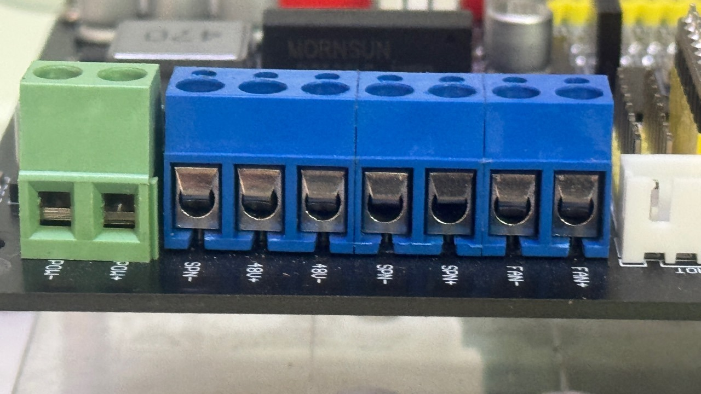
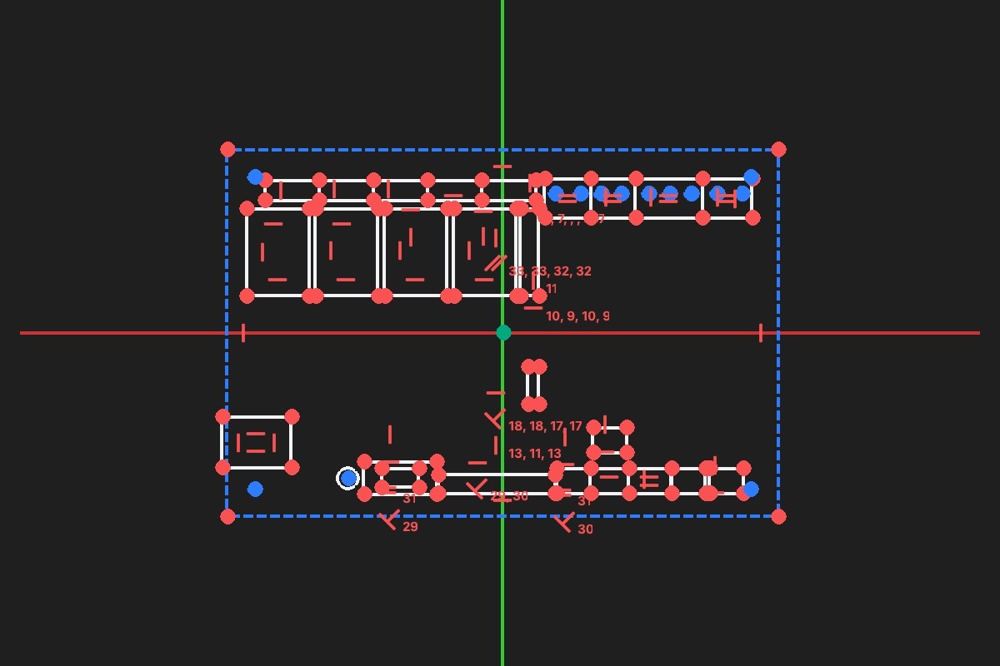

# Procedural Voronoi Mesh

### A repeatable geometry tool that grew out of a real CNC controller enclosure

I’m David Cannan (Cdaprod), a self-taught software and systems engineer. I started this project while trying to fit a measured Doesbot CNC controller inside an enclosure with working connector openings, supports, and mounting references. The procedural surface came later.


*Rendered from the saved V24 lid/base exports and positioned PCB/component geometry. The assembly is a computational review candidate; physical fit and manufacturing are unverified.*

The generator is now a standalone Python library, CLI, and local browser for making seeded Voronoi relief meshes. The enclosure and its CAD history remain separate from the reusable software.

## The hardware that started it

The board already had connectors, terminal screws, headers, and mounting features. Those interfaces set the mechanical problem: an organic surface had to leave the actual hardware usable.


*Physical top-side board reference from the enclosure work. It documents the overall component layout; the photograph alone is not a dimensioned model.*



*User-supplied hardware photograph from the enclosure work. This close-up documents the connector arrangement; it is not a calibrated drawing.*

## From board references to enclosure geometry

Before building the enclosure, I mapped the board's interfaces in FreeCAD Sketcher. The master sketch records the geometric relationships used to place later component references and enclosure openings.



*Historical FreeCAD sketch screenshot showing dimensional and geometric references. These sketch constraints are design inputs, not evidence that every later physical clearance is accepted.*

The FreeCAD work kept a constrained PCB master and component placements as the reference for openings and access features. The saved V005 component view shows the modeled board and installed connector geometry, including the 8×2 and 10×2 male headers.


*Saved native assembly reference view. It is a component-layout reference, not a claim that every simplified component solid matches a manufacturer STEP model.*

The R08 access work made the dependency path explicit: housing placement drives screw axes, and those axes drive the throat and chamfer tools.


*Geometry-derived FreeCAD review diagram. The enclosure CAD itself is not distributed in this repository.*

## The cover and the assembled parts

These local Blender Cycles renders use the saved V24 lid STL, base STL, and PCB/component assembly OBJ. I import the meshes in the shared millimetre frame. The closed view does not alter placement; the exploded view moves the cover, PCB, and references along assembly Z for inspection.

The closed pose appears above. The following views show the same source geometry separated for inspection and the individual lid/base interiors.


*Display-only translations are along Z; component rotations and XY registration stay fixed. This is not a physical assembly photograph.*


The saved V23 + R07 cover-only view records the earlier enclosure surface before the V24 assembly presentation.


*Historical V23 + R07 computational render; the image does not imply a parametric reconstruction or physical acceptance.*

## Two rendering paths

GitHub Actions continues to render generated preset meshes for deterministic software examples. The optional Blender script renders the saved V24 mechanical assembly at higher quality on a local GPU. The generic green test slabs remain in the [full preset gallery](docs/gallery/README.md), not as the enclosure's stand-in.

The Blender camera, materials, lighting, quality profiles, render manifest, and commands are documented in the [local rendering guide](docs/rendering/README.md). The 4K PNG masters are generated locally; optimized previews are committed and embedded here.

The R07 work also required checking the native support against the cover in section. The image below records that local geometry review; it does not certify the complete enclosure.


*Saved computational section from the R07 integration work. The local interface and surrounding mesh still require physical verification.*

[See the enclosure case study and its development images](docs/showcase/doesbot-cnc-enclosure.md).

## The reusable generator

The public engine creates a sampled Voronoi relief field from explicit sites and a seeded NumPy random generator. Presets configure distribution, relief style, height, boundaries, protected rectangles, and solidification. The same implementation runs through the Python API, CLI, and local browser.


*These are generated slab examples for comparing relief behavior. They are software examples, not the Doesbot enclosure.*

The recovered Doesbot experiment records seed **20261110**, **55 cells**, and **1.8 mm relief**. The public reference applies those values to a sanitized slab. It is not an exact V23 reconstruction; enclosure supports, openings, reinforcement, and mating changes belong to the separate CAD workflow. [Historical example and provenance](examples/doesbot/README.md).

## Install and generate

Python 3.11 or newer. FreeCAD and Blender are optional; neither is required.

```sh
git clone https://github.com/Cdaprod/procedural-voronoi-mesh.git
cd procedural-voronoi-mesh
python -m venv .venv
# macOS/Linux; Windows: .venv\Scripts\activate
. .venv/bin/activate
python -m pip install '.[validation]'
voronoi-mesh generate --output output/default
```

One command generates STL, OBJ, GLB, 3MF, a PNG, `resolved.yaml`, `validation.json`, and `manifest.json`. Omit `--output` to use `output/`. Install without `[validation]` for the lighter runtime; CGAL self-intersection checking is then explicitly reported as unavailable. Manufacturing presets require it.

## Presets, seeds, and inputs

```sh
voronoi-mesh presets
voronoi-mesh presets crystalline
voronoi-mesh generate --preset organic-inverted --seed 42 --cells 70 --relief 2.0 --output output/inverted
voronoi-mesh generate --preset protected-boundary --output output/protected
voronoi-mesh generate --input box --output output/box
voronoi-mesh generate --input examples/imported-mesh/input.obj --relief 0.5 --output output/imported
voronoi-mesh batch --preset crystalline --seed 100 --count 3 --output output/batch
voronoi-mesh reproduce examples/presets/organic-raised/manifest.json --output output/reproduced
voronoi-mesh validate output/default/mesh.stl --closed
```

All coordinates are millimetres, XY is the relief domain, and Z points out of the surface. Imported STL/OBJ/GLB geometry must be centered and fit the configured XY bounds. Existing +Z-facing vertices are displaced; arbitrary curved surfaces are not conformally remeshed. See [input requirements and algorithm](docs/engineering/guide.md).

Fifteen ready-to-run presets cover raised and inverted organic relief, flowing and crystalline surfaces, low-poly and fractured patterns, protected regions, constant vertical thickness, Doesbot-era settings, and preview/detail/manufacturing configurations. Each has generated geometry, a preview, validation, and a reproduction manifest. [Browse the full preset gallery](docs/gallery/README.md).

## Local browser

```sh
voronoi-mesh serve --port 8765
```

Open **http://127.0.0.1:8765**. Change seed, cells, relief, mode, primitive, format, and quality, then generate and download. The preview is rendered from the same mesh engine used by the CLI. The browser supports plane/box input; imported files use the CLI. The server binds only to loopback and runs generation sequentially.

## Validation and reproducibility

Exports are reloaded before checking components, watertightness, winding, positive volume, edge incidence, duplicate/degenerate/near-zero triangles, and independent CGAL self-intersections when installed. Open surfaces have different acceptance criteria from solids. Protected masks and vertical grid thickness are reported; minimum normal thickness of imported or sloped shells is not certified.

The same supported dependency environment, inputs, seed, and configuration produces repeatable geometry. Tests check geometry hashes and byte-identical STL/OBJ/GLB/3MF exports. PNG/manifest byte identity across platforms is not promised. Every manifest records input hashes, configuration, dependency versions, geometry statistics, validation, and file hashes. Changing dependencies can change triangulation or numeric results; use recorded versions when reproducing.

Computational checks describe the generated mesh. They do not prove hardware clearance, physical fit, print success, or manufacturing acceptance.

## Documentation

- [Doesbot CNC enclosure case study](docs/showcase/doesbot-cnc-enclosure.md) — actual hardware, FreeCAD references, cover, assembly, and mechanical review imagery.
- [Engineering story](docs/story/from-hardware-to-procedural-geometry.md)
- [Geometry engine and engineering guide](docs/engineering/guide.md)
- [Generated preset gallery](docs/gallery/README.md)
- [Historical Doesbot reference](examples/doesbot/README.md)
- [Publication drafts](docs/publications/README.md)
- [Visual asset provenance](docs/assets/manifest.json)
- [Blender and GitHub Actions rendering guide](docs/rendering/README.md)

## Development

```sh
python -m pip install -e '.[dev,validation]'
pytest
python scripts/check_docs.py
python scripts/build_examples.py
ruff check src tests scripts
python -m build
```

Current scope: planar and box height relief, directional relief on imported meshes, protected rectangles, optional sampled point relaxation, deterministic presets, library/CLI/browser workflows, and portable exports. Limitations include no arbitrary normal-direction solidification, no physical manufacturing certification, no exact V23 replay, and no automatic repair of invalid imports. Strict validation rejects unresolved checks instead of concealing them.

Author: **[David Cannan (Cdaprod)](https://github.com/Cdaprod)**. [MIT license](LICENSE). Contributions and reproducible bug reports are welcome.
