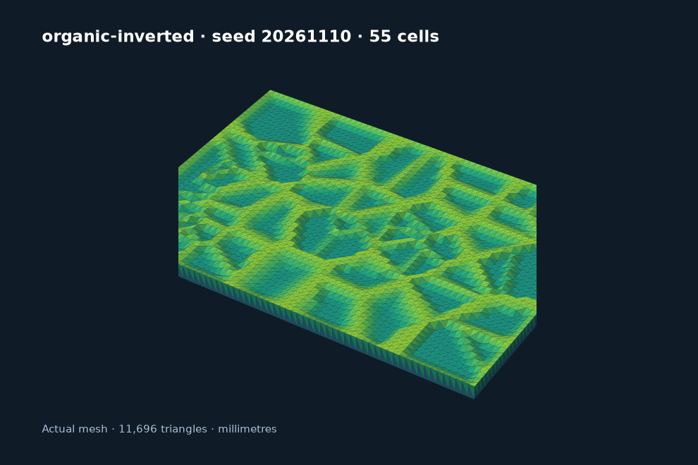
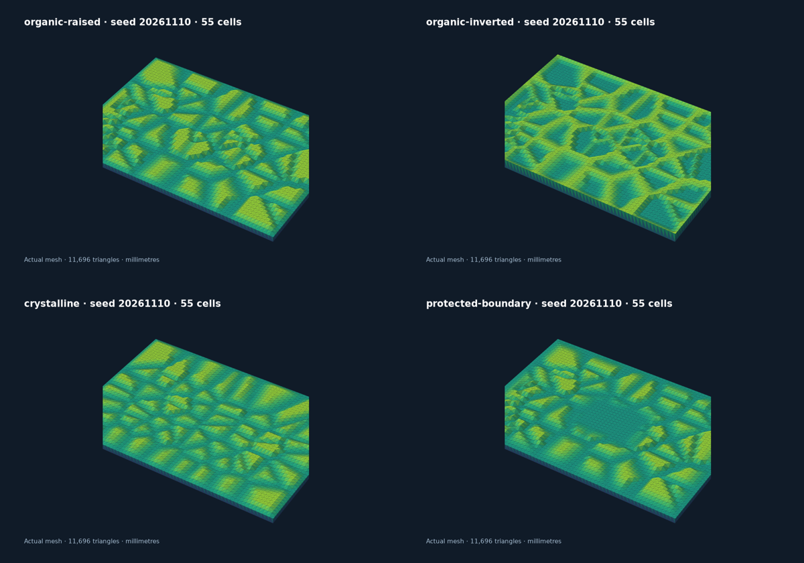
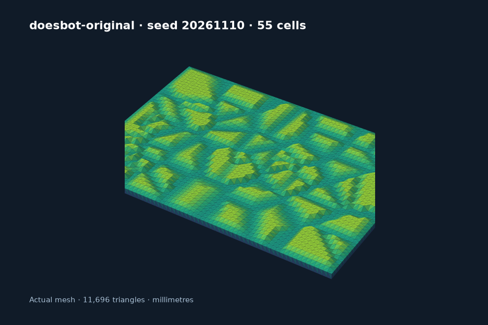

# Procedural Voronoi Mesh

I’m David Cannan (Cdaprod), a self-taught software and systems engineer. I built this tool while trying to turn a measured CNC controller enclosure into geometry I could generate, inspect, and repeat. It now stands on its own: a Python library, CLI, and local browser for seeded Voronoi relief meshes.


These are geometry-derived renders of exported meshes. The software checks computational geometry; it does not certify physical fit or print success.

## Install and generate

Python 3.11 or newer. FreeCAD and Blender are **optional**; neither is required.

```sh
git clone https://github.com/Cdaprod/procedural-voronoi-mesh.git
cd procedural-voronoi-mesh
python -m venv .venv
# macOS/Linux; Windows: .venv\Scripts\activate
. .venv/bin/activate
python -m pip install '.[validation]'
voronoi-mesh generate --output output/default
```

One command generates STL, OBJ, GLB, 3MF, a PNG, `resolved.yaml`, `validation.json`, and `manifest.json`. Omit `--output` to use `output/`. Install without `[validation]` for the lighter runtime; CGAL self-intersection checking is then explicitly reported as unavailable. Manufacturing presets require it.

## Presets, seeds, and input geometry

```sh
voronoi-mesh presets
voronoi-mesh presets crystalline
voronoi-mesh generate --preset organic-inverted --seed 42 --cells 70 --relief 2.0 --output output/inverted
voronoi-mesh generate --preset protected-boundary --output output/protected
voronoi-mesh generate --input box --output output/box
voronoi-mesh generate --input examples/imported-mesh/input.obj --relief 0.5 --output output/imported
voronoi-mesh batch --preset crystalline --seed 100 --count 3 --output output/batch
voronoi-mesh reproduce examples/presets/organic-raised/manifest.json --output output/reproduced
voronoi-mesh validate output/default/mesh.stl --closed
```

All coordinates are millimetres, XY is the relief domain, and Z points out of the surface. Imported STL/OBJ/GLB geometry must be centered and fit the configured XY bounds. Existing +Z-facing vertices are displaced; arbitrary curved surfaces are not conformally remeshed. See [input requirements and algorithm](docs/engineering/guide.md).

| Raised cell centers | Inverted cell centers |
|---|---|
|  |  |



Fifteen ready-to-run presets include organic raised/inverted, flowing, crystalline, low-poly, fractured, protected-boundary, constant-thickness, four preserved Doesbot-era names, and preview/detail/manufacturing settings. Every preset has checked outputs and a reproducible manifest. [Full gallery](docs/gallery/README.md).

## Local browser

```sh
voronoi-mesh serve --port 8765
```

Open **http://127.0.0.1:8765**. Change seed, cells, relief, mode, primitive, format, and quality, then generate and download. The preview is rendered from the same mesh engine used by the CLI. The browser supports plane/box input; imported files use the CLI. The server binds only to loopback and runs generation sequentially.

## Historical Doesbot reference

```sh
voronoi-mesh doesbot --output output/doesbot-reference
```



The recovered evidence records seed **20261110**, **55 cells**, and **1.8 mm relief**. This example uses those settings on a distributable slab. It is **not an exact reconstruction of the V23 enclosure**. V23 reinforcement, later native R07 supports, and V24 mating corrections are separate engineering operations. [Reference evidence](examples/doesbot/README.md).

## Validation and reproducibility

Exports are reloaded before checking components, watertightness, winding, positive volume, edge incidence, duplicate/degenerate/near-zero triangles, and independent CGAL self-intersections when installed. Open surfaces have different acceptance criteria from solids. Protected masks and vertical grid thickness are reported; minimum normal thickness of imported or sloped shells is not certified.

The same supported dependency environment, inputs, seed, and configuration produces repeatable geometry. Tests check both geometry hashes and byte-identical STL/OBJ/GLB/3MF exports. PNG/manifest byte identity across platforms is not promised. Every manifest records input hashes, configuration, dependency versions, geometry statistics, validation, and file hashes. Changing dependencies can change triangulation or numeric results; use recorded versions when reproducing.

[Python API and engineering details](docs/engineering/guide.md) · [Engineering story](docs/story/from-hardware-to-procedural-geometry.md) · [Gallery](docs/gallery/README.md) · [Publication drafts](docs/publications/README.md)

## Development

```sh
python -m pip install -e '.[dev,validation]'
pytest
python scripts/check_docs.py
python scripts/build_examples.py
ruff check src tests scripts
python -m build
```

Current scope: planar and box height relief, directional relief on imported meshes, protected rectangles, optional sampled point relaxation, deterministic presets, library/CLI/browser workflows, and portable exports. Limitations include no arbitrary normal-direction solidification, no physical manufacturing certification, no exact V23 replay, and no automatic repair of invalid imports. Strict validation rejects unresolved checks instead of concealing them.

Author: **[David Cannan (Cdaprod)](https://github.com/Cdaprod)**. [MIT license](LICENSE). Contributions and reproducible bug reports are welcome.
