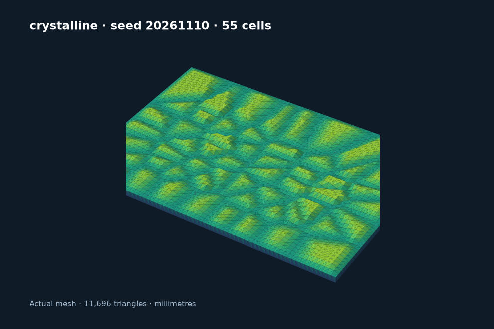
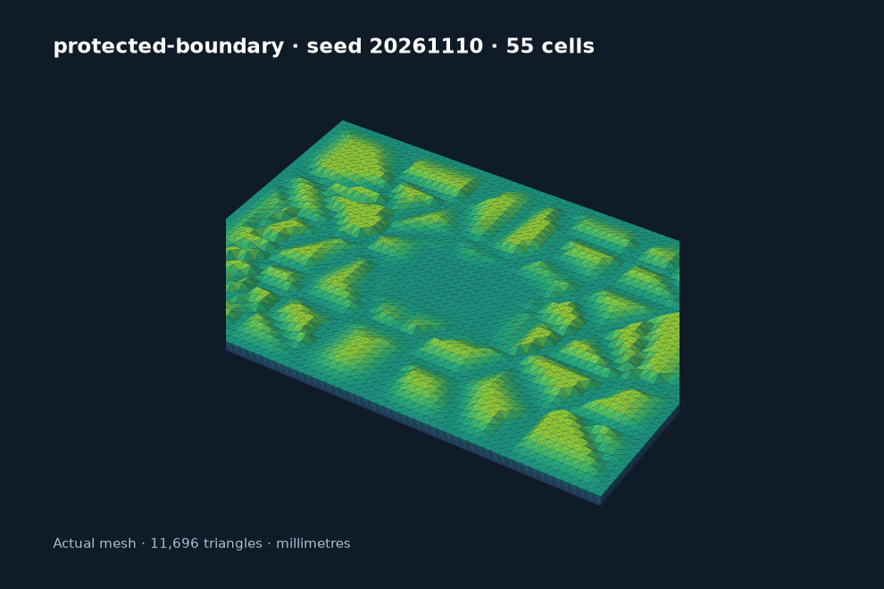

# Geometry engine and engineering contract

## Pipeline and algorithm

`config.resolve` owns configuration precedence: built-in defaults → named preset → YAML user mapping → explicit CLI overrides. Unknown keys, unsupported enums, invalid sizes and excessive cells/resolution fail with actionable errors. `resolved.yaml` is the complete effective configuration. Presets are packaged into the wheel; installation does not depend on the source checkout.

`geometry.sites` initializes a local NumPy `default_rng(seed)`. Uniform sites preserve historical independent X/Y draw ordering. Jittered sites fill a regular grid; clustered sites use deterministic centers and offsets. Relaxation assigns a fixed 96×72 sampling grid to the nearest site and moves sites to the sample centroids. This is approximate Lloyd relaxation, not an exact polygon-centroid solver.

For each surface sample I query the nearest two sites. The difference of squared distances divided by site separation gives an edge-distance relief coordinate. The field is sampled into triangular facets; this implementation does not export exact analytic Voronoi cell polygons. Organic modes apply a smoothstep. Crystalline/angular modes retain the linear field. Flowing mode warps query coordinates. Fractured mode varies peak heights by a second local seeded RNG.



## Boundary and protected regions

The XY rectangle boundary fades relief to zero. Protected rectangles are JSON/YAML mappings with `xmin`, `xmax`, `ymin`, `ymax` in millimetres. Relief is exactly zero within each rectangle and transitions outside it. These are exclusion masks for displacement, not holes or arbitrary bitmap masks. Flat mode leaves the baseline flat. No repair or independent coordinate changes are applied.



## Coordinate system, units and input

All numeric distances are millimetres. Procedural plane and box surfaces are centered at XY=0, relief uses +Z, and the solid substrate starts at Z=0. Boxes are solid rectangular height shells whose height is `thickness`. `mode: inverted` lowers the relief from an elevated baseline while retaining at least the configured vertical substrate.

STL, OBJ, and GLB scenes are loaded by Trimesh, flattened with scene transforms, and uniformly scaled by `scale`. Units stored by a source file are not automatically converted. Configure `scale` explicitly (for example 25.4 for inches). Imported XY bounds must fit width/height and the file should be centered. Vertices whose original normal has Z>0.5 receive directional relief. Other vertices and protected regions stay fixed. Existing tessellation is retained; coarse imports will show coarse relief. No arbitrary UV mapping, remeshing or adaptive refinement is promised. Empty/non-finite files and unsupported suffixes fail. Open imports require `solidify: false`; closed imported solids retain their existing shell.

## Solidification and thickness

Procedural surfaces use explicit top, bottom, and side triangles. `solidify: false` returns an open decorative surface. `constant_thickness: true` offsets paired bottom vertices vertically by `thickness`; this provides constant **vertical** thickness, not constant shortest normal distance. Otherwise the underside is flat. The validation report states the known paired-grid vertical minimum. Imported normal/vertical minimum thickness is unknown. Manufacturing presets require a supported procedural slab, independent self-intersection checking, valid single-solid topology and minimum vertical thickness; they do not imply manufacturing acceptance.

## Formats and determinism

Canonical geometry sorts vertices by exact coordinates, cyclically normalizes triangle winding without reversing it, and orders triangles lexicographically. Exports: binary STL, text OBJ, GLB, and a minimal standard 3MF package. 3MF uses millimetre units, fixed ZIP timestamps, a single mesh object, and no printer-specific settings. PNGs use the actual triangles through a headless Matplotlib renderer. Independent tests reload all mesh formats. Export floating-point precision differs: STL/GLB generally use float32; exact cross-format coordinate equality is not promised. Same-format repeated bytes are tested.

The manifest stores the semantic generator version, exact dependency versions, complete configuration, seed, input copy/hash, in-memory geometry hash, reloaded geometry hashes, validation and every output hash. Reproduce uses the copied input and checks the regenerated geometry hash. Dependencies are recorded, not automatically downloaded by the manifest; a mismatch is an explicit error. No claims of cross-version bit identity are made.

## Python API

```python
from procedural_voronoi import generate
from procedural_voronoi.pipeline import reproduce

manifest = generate(
    "output/library-example",
    preset="organic-raised",
    overrides={"seed": 42, "cells": 35, "relief": 1.2},
)
assert manifest["validation_pass"]
reproduce("output/library-example/manifest.json", "output/library-reproduction")
```

`generate` writes files and returns the manifest. `resolve` returns a validated configuration. `construct` returns `(trimesh.Trimesh, metrics)`. `validate(path, closed=...)` returns checks without automatically repairing the mesh. Generating into a directory with a different saved configuration is rejected to prevent accidental replacement.

## Validation and limitations

Validation reloads each export and welds vertices by exact coordinates. It checks finite vertices, vertex connectivity, edge incidence, winding, enclosed volume for closed solids, duplicates, degenerate/near-zero triangle area and independent libigl/CGAL self-intersections. The basic install reports CGAL as unavailable; strict presets fail when it is absent. Mesh topology cannot establish hardware clearance, screw access, stiffness, heat behavior, printer calibration or successful physical fit. No global mesh repair runs silently.

Known limitations: directional imported displacement can cause self-intersections; reports expose them. High resolution or 1000-cell batches can consume substantial memory. The browser is local and sequential. The generated “fractured” look is a connected relief, not a destructive fracture simulator. The original organic V23 shell, its later Boolean integrations and this public generator are distinct artifacts.
