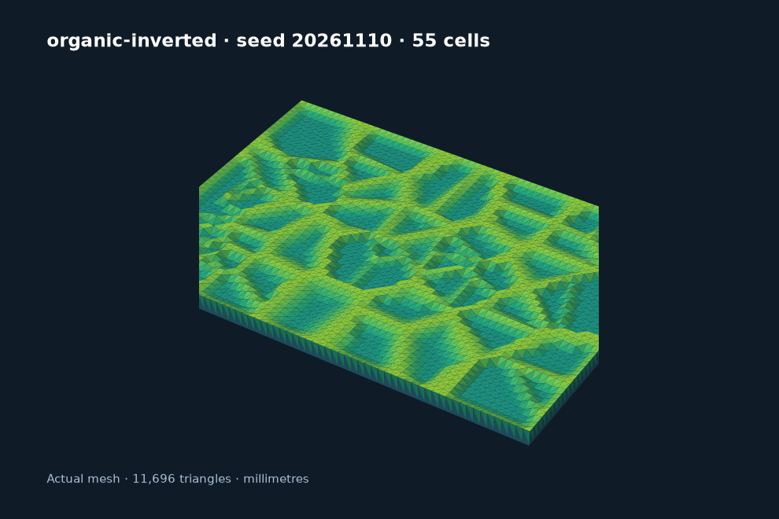
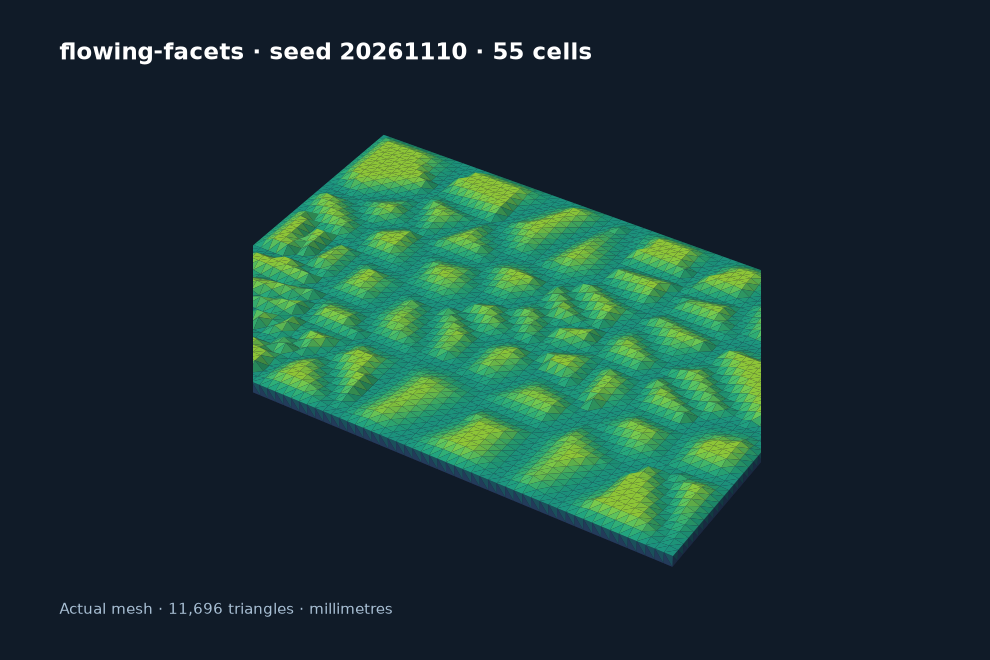
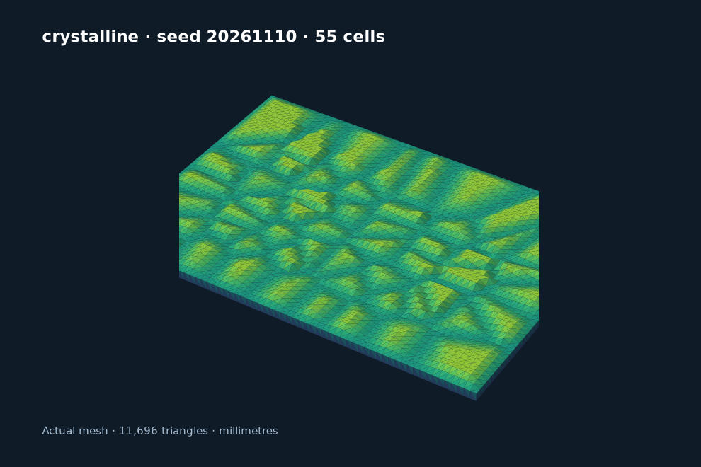
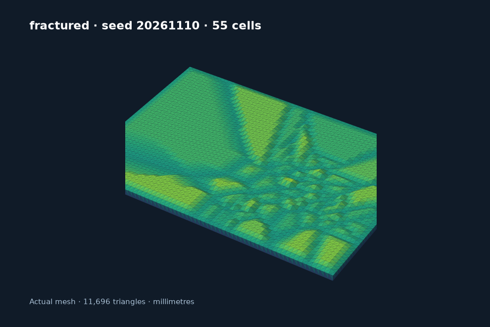
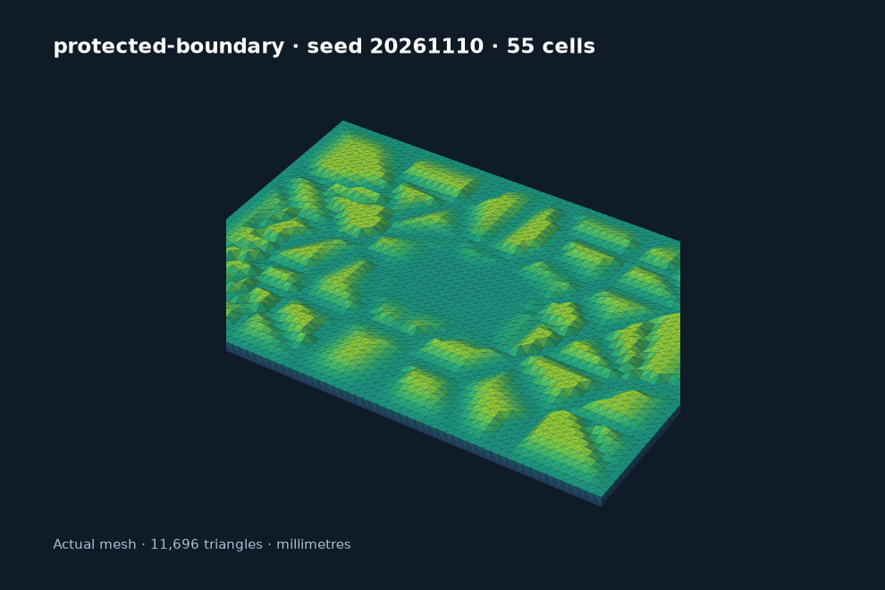
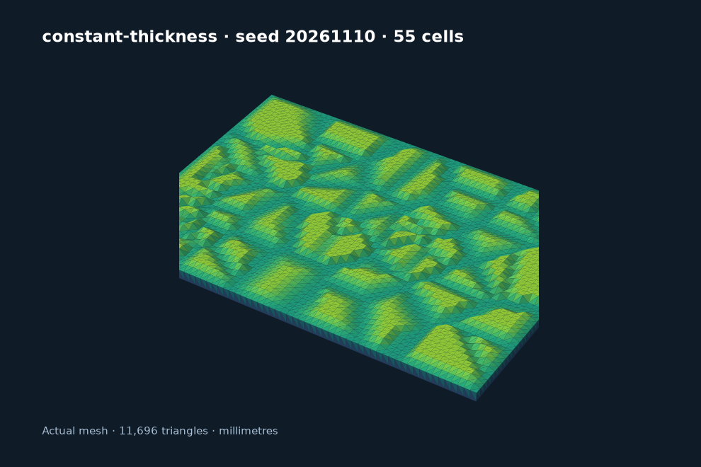
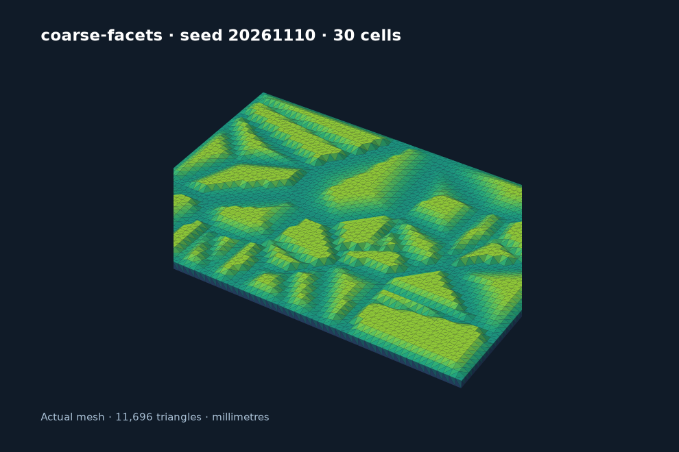
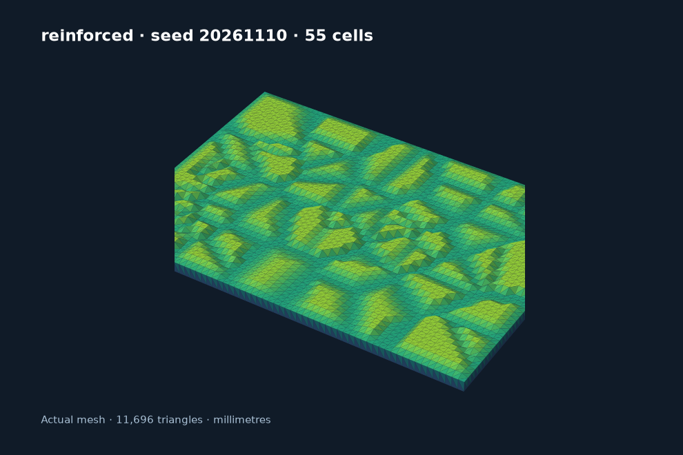
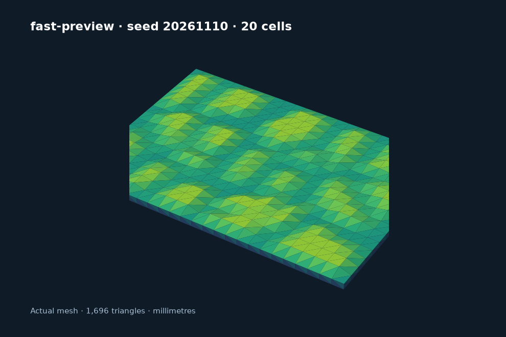
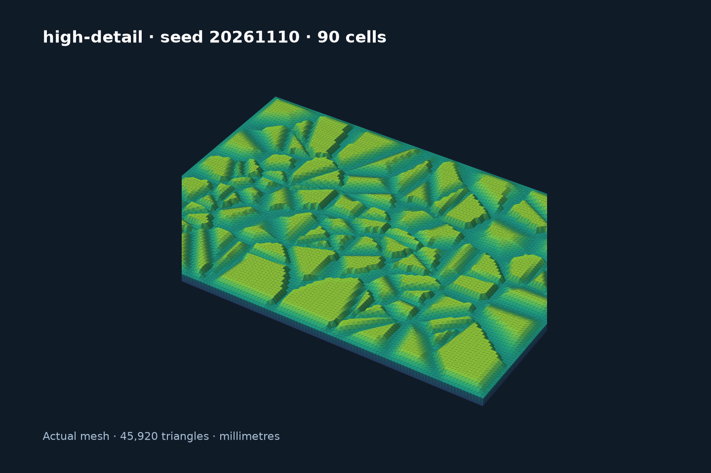

# Generated preset gallery

Every image below is rendered from the actual exported geometry in examples/presets/. Each folder includes STL/OBJ/GLB/3MF, resolved configuration, validation and manifest. Camera conventions are shared; flat/inverted baselines differ as documented.

## organic-inverted

Rounded inward Voronoi relief over a solid slab.



```sh
voronoi-mesh generate --preset organic-inverted --output output/organic-inverted
```

[Resolved build and validation](../../examples/presets/organic-inverted/README.md)

## organic-raised

Rounded raised Voronoi cell centers.


```sh
voronoi-mesh generate --preset organic-raised --output output/organic-raised
```

[Resolved build and validation](../../examples/presets/organic-raised/README.md)

## flowing-facets

Coordinate-warped cells with softened relief.



```sh
voronoi-mesh generate --preset flowing-facets --output output/flowing-facets
```

[Resolved build and validation](../../examples/presets/flowing-facets/README.md)

## crystalline

Sharper piecewise linear crystalline center peaks.



```sh
voronoi-mesh generate --preset crystalline --output output/crystalline
```

[Resolved build and validation](../../examples/presets/crystalline/README.md)

## low-poly

Sparse angular surface sampling and low cell count.


```sh
voronoi-mesh generate --preset low-poly --output output/low-poly
```

[Resolved build and validation](../../examples/presets/low-poly/README.md)

## fractured

Clustered sites with varying deterministic peak heights.



```sh
voronoi-mesh generate --preset fractured --output output/fractured
```

[Resolved build and validation](../../examples/presets/fractured/README.md)

## protected-boundary

Fixed outer boundary and a flat protected central rectangle.



```sh
voronoi-mesh generate --preset protected-boundary --output output/protected-boundary
```

[Resolved build and validation](../../examples/presets/protected-boundary/README.md)

## constant-thickness

Vertical constant-thickness shell; normal thickness is not constant.



```sh
voronoi-mesh generate --preset constant-thickness --output output/constant-thickness
```

[Resolved build and validation](../../examples/presets/constant-thickness/README.md)

## doesbot-original

Historical seed/cells/relief on a sanitized reference slab, not V23.


```sh
voronoi-mesh generate --preset doesbot-original --output output/doesbot-original
```

[Resolved build and validation](../../examples/presets/doesbot-original/README.md)

## fine-facets

Fine 90-cell sampling.


```sh
voronoi-mesh generate --preset fine-facets --output output/fine-facets
```

[Resolved build and validation](../../examples/presets/fine-facets/README.md)

## coarse-facets

Coarse 30-cell sampling.



```sh
voronoi-mesh generate --preset coarse-facets --output output/coarse-facets
```

[Resolved build and validation](../../examples/presets/coarse-facets/README.md)

## reinforced

Thicker substrate with strict computational validation.



```sh
voronoi-mesh generate --preset reinforced --output output/reinforced
```

[Resolved build and validation](../../examples/presets/reinforced/README.md)

## fast-preview

Quick low-resolution generation.



```sh
voronoi-mesh generate --preset fast-preview --output output/fast-preview
```

[Resolved build and validation](../../examples/presets/fast-preview/README.md)

## high-detail

Dense sampling for export.



```sh
voronoi-mesh generate --preset high-detail --output output/high-detail
```

[Resolved build and validation](../../examples/presets/high-detail/README.md)

## manufacturing

Conservative vertical substrate thickness with strict topology gates.


```sh
voronoi-mesh generate --preset manufacturing --output output/manufacturing
```

[Resolved build and validation](../../examples/presets/manufacturing/README.md)
