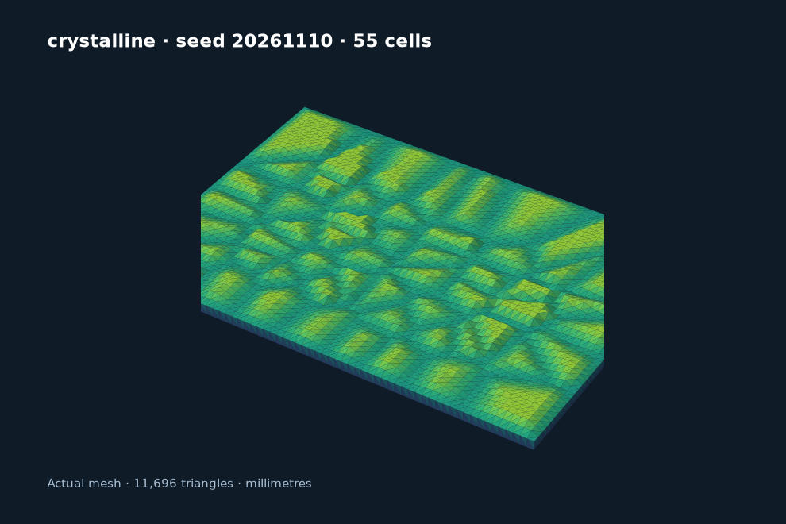

# Short project announcement

I turned part of my CNC enclosure workflow into a reusable seeded Voronoi mesh generator: Python API, CLI, local browser, working presets, actual geometry previews, and reproducible manifests.

Code and engineering story: https://github.com/Cdaprod/procedural-voronoi-mesh

Computational geometry checks included; physical print fit is not claimed.

— David Cannan (Cdaprod)
