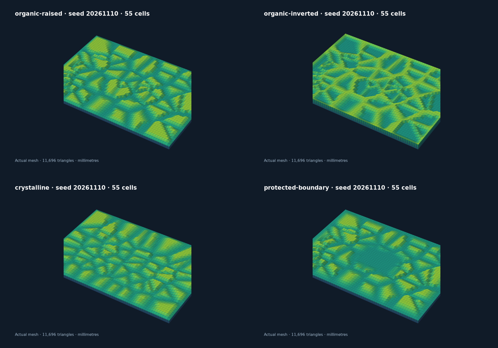

# I turned a CNC enclosure experiment into a seeded mesh generator

I started with a practical problem: model an enclosure around a Doesbot controller without losing the relationship between its connectors, header pins, terminal screws, and mounting points. The organic Voronoi surface was the visible part, but the mechanical references were what made it useful.

I learned that native CAD features and triangle meshes need different workflows. Converting hundreds of thousands of triangles into individual B-rep faces was not a useful shortcut to a parametric model. Native references could define mechanical supports, while mesh operations handled their integration into the organic exterior. Independent validation after export mattered because a successful Boolean was not a guarantee of clean topology or physical clearance.

The reusable result is procedural-voronoi-mesh: a Python library, CLI, and local browser with deterministic seeds, preset configurations, protected regions, portable mesh exports, actual triangle renders, and saved build manifests.

I preserved the historical Doesbot parameter evidence—seed 20261110, 55 cells, 1.8 mm relief—without claiming that those three numbers reproduce the final V23 enclosure. The public reference is a sanitized new slab. The enclosure’s later supports and mating corrections are separate operations.

You can generate a default example with `voronoi-mesh generate`, inspect its validation JSON, and reproduce it from the manifest. I’ve included working presets and examples because a library that leaves all the configuration work to its first user is not the tool I wanted to ship.

The limitations are explicit: vertical thickness is not normal thickness, imported meshes need appropriate tessellation and +Z orientation, and mesh topology does not prove physical printability. The software is an engineering tool, not a fit certificate.

Source and examples: https://github.com/Cdaprod/procedural-voronoi-mesh

— David Cannan (Cdaprod)
