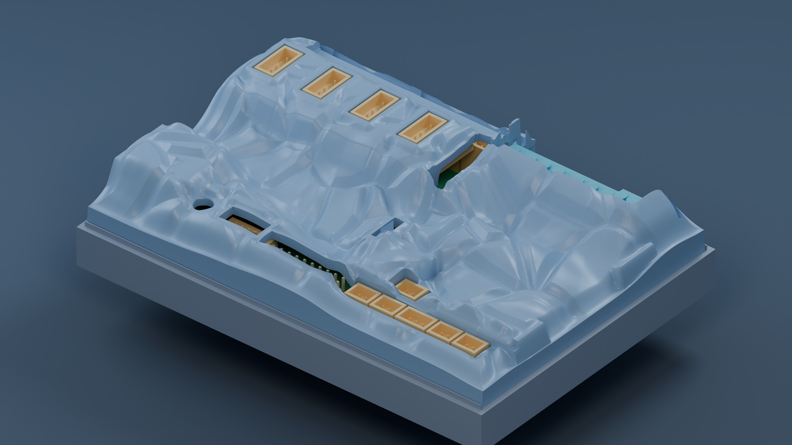
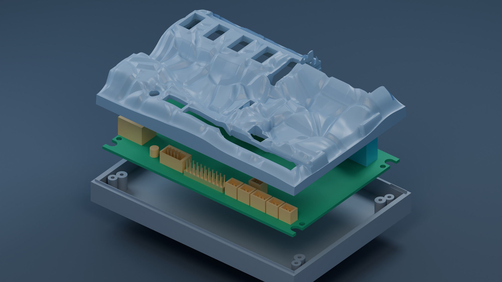
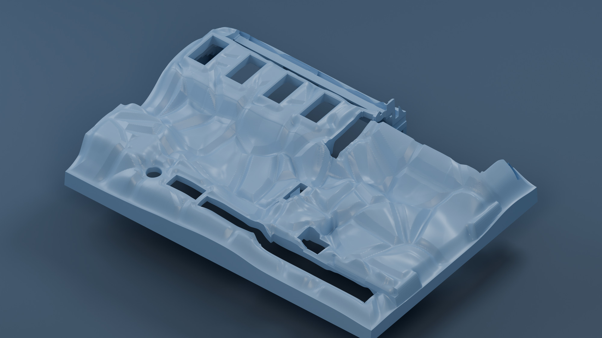
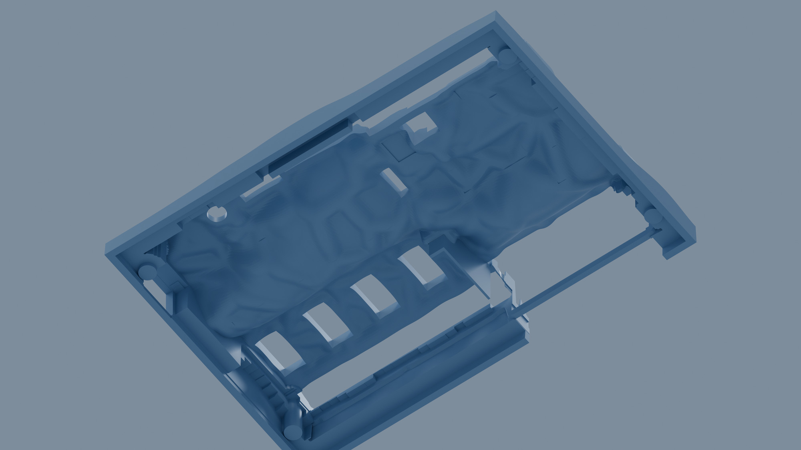
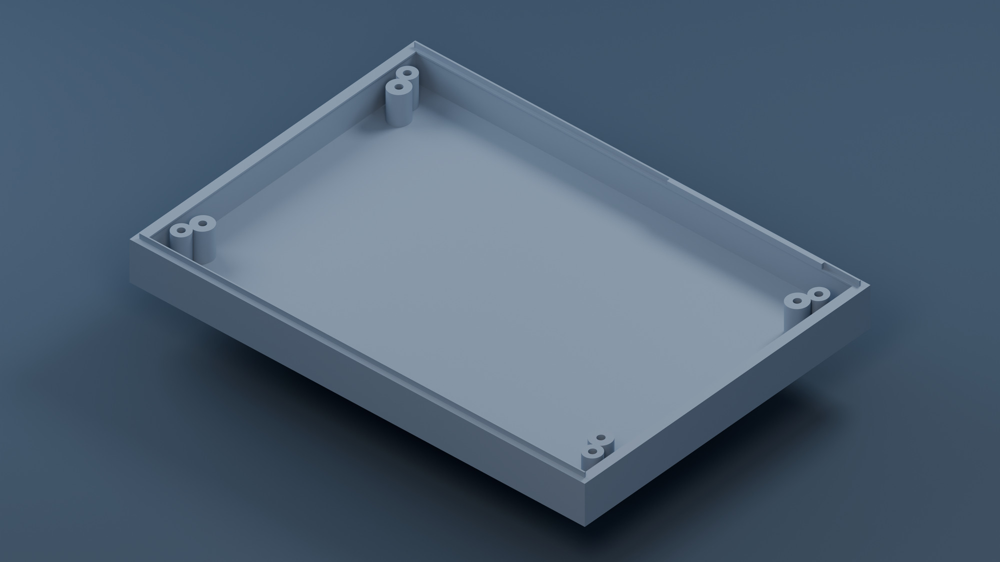

# Two rendering tiers

I use two render paths for different jobs. The GitHub Actions artifacts are quick, consistent views of generated meshes and preset changes. The optional local Blender pipeline presents saved CAD-derived enclosure geometry with a controllable Cycles studio setup. The Blender images are not outputs of the generic slab generator.

## Saved V24 geometry

These are Cycles renders from the V24 lid and base STL exports plus the saved PCB/component assembly OBJ. The objects import in the shared millimetre coordinate frame with no scaling or rotations. The OBJ is imported with its native Z-up axis explicitly selected; this avoids Blender's default Y-up conversion.



*Closed assembly view. The meshes and component references remain in their saved placement. Physical fit is not established by this render.*



*Presentation-only movement is along assembly Z: lid +48 mm; PCB and component references +20 mm. Component rotations and X/Y registration are retained. These offsets are for legibility, not a proposed mechanical pose.*







## Re-render from local engineering files

Blender is an optional presentation dependency. The reproducible Python generator, its CLI, and its GitHub Actions preview renderer do not require Blender. The enclosure CAD references are not distributed in this repository; provide the existing V24 completion export directory locally.

Requirements: Blender 4.2 or newer, Python with the repository's Pillow dependency, and the saved V24 outputs arranged as:

```text
$DOESBOT_V24_DIR/
├── exports/lid.stl
├── exports/base.stl
└── references/assembly.obj
```

On macOS with the V24 completion package available:

```sh
python -m pip install '.[dev]'
export DOESBOT_V24_DIR="/path/to/doesbot-cnc-enclosure-v24-completion"
scripts/render_showcase.sh
```

The default profile renders 3840×2160 PNG masters at 160 Cycles samples, selects the Metal device when Blender exposes it, writes an input-hash manifest, and creates optimized 2000-pixel JPEG copies for Markdown under `docs/assets/images/showcase/`. The 4K masters stay in the ignored local `rendered/doesbot-v24/masters/` directory; the smaller reviewed images are the repository assets.

Change the quality or backend without changing geometry:

```sh
BLENDER_PRESET=draft BLENDER_DEVICE=metal scripts/render_showcase.sh
BLENDER_PRESET=web BLENDER_DEVICE=auto scripts/render_showcase.sh
BLENDER_BIN=/custom/path/to/blender BLENDER_PRESET=master scripts/render_showcase.sh
```

Profiles, camera directions, framing, stage lighting, materials, and display-only exploded distances live in [`doesbot-v24-blender.json`](doesbot-v24-blender.json). Each run records Blender version, selected device, source hashes, settings, and per-view mesh bounds in [`v24-render-manifest.json`](v24-render-manifest.json), alongside a local copy beside the masters.

`Cycles/Metal` is only used by this local showcase path. The committed procedural examples remain rendered from their generated meshes by the generator's existing renderer and CI workflow, so software previews stay fast and stable across CI hosts.

## Interpretation limits

Materials, area lights, cameras, and the studio floor affect pixels only. The script does not edit, repair, or export CAD geometry. The exploded view applies display translations along Z only. The assembly OBJ contains reference component meshes, some of which are simplified; the render cannot establish real hardware dimensions, clearance, fit, print behavior, or manufacturing acceptance. The committed V24 views are computational-review images.
