# Doesbot CNC controller enclosure: engineering case study

The procedural Voronoi Mesh project grew out of a real enclosure problem. This page collects the hardware, reference geometry, saved enclosure views, and software work in one place. I’m David Cannan (Cdaprod), a self-taught software and systems engineer; I used programming and repeatable geometry experiments to work through the mechanical design.

The enclosure images below are computational review artifacts from the saved engineering history. They are not evidence of a successful physical fit or print.

## Hardware and component references

The actual controller board supplied the connector arrangement and the interfaces the enclosure needed to preserve.

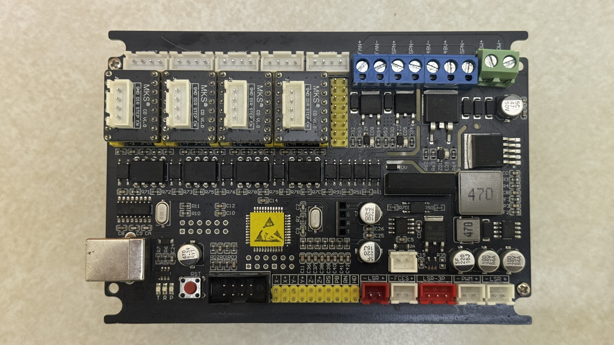

*Physical board overview used as a placement reference. Visible component positions are not a substitute for measured envelope dimensions.*

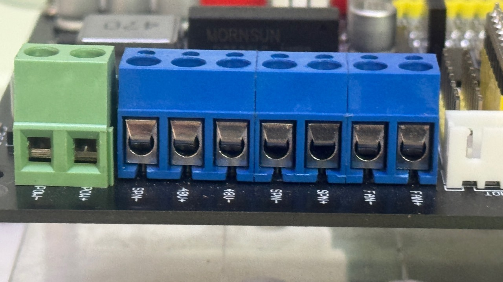

*User-supplied hardware photograph. It is a close-up reference, not a dimensioned drawing.*

The stepper-drive headers and adapter hardware are useful supplementary references because a component's usable envelope includes connectors, installed accessories, and access space—not just the board outline.

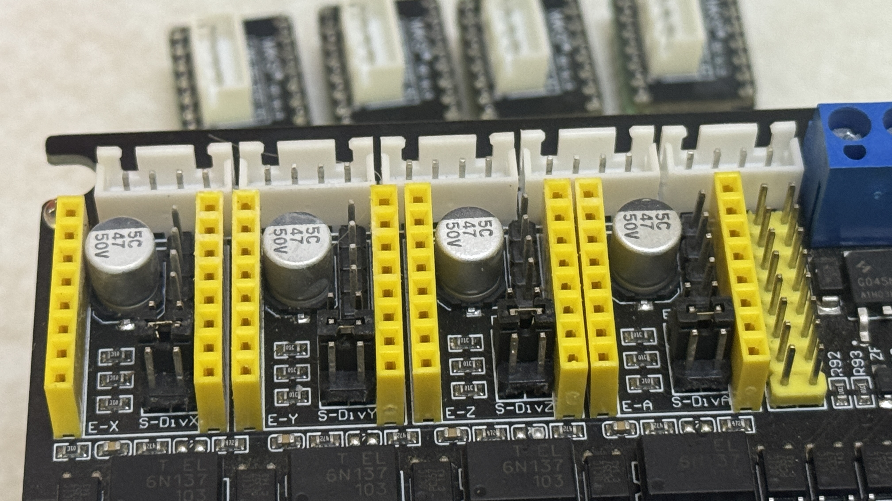

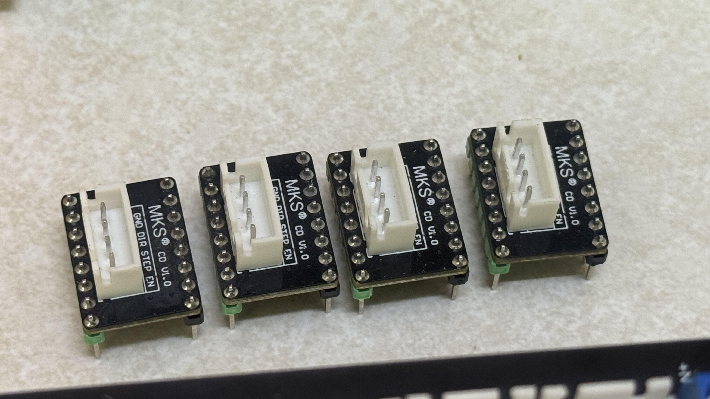

*Physical reference images only. Connector compatibility, installed orientation, dimensions, and clearances must be established independently.*

The FreeCAD reference assembly let me inspect the PCB, connector bodies, terminal groups, headers, and mounting locations together.

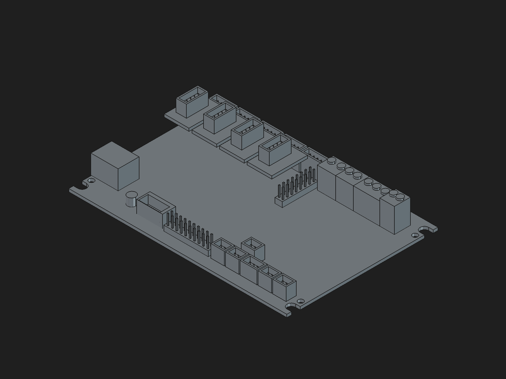

*Saved V005 native component reference view. Some solids are simplified reference geometry; they are not all verified manufacturer models.*

The header detail shows why the 8×2 and 10×2 pin components needed to remain visible in assembly views.

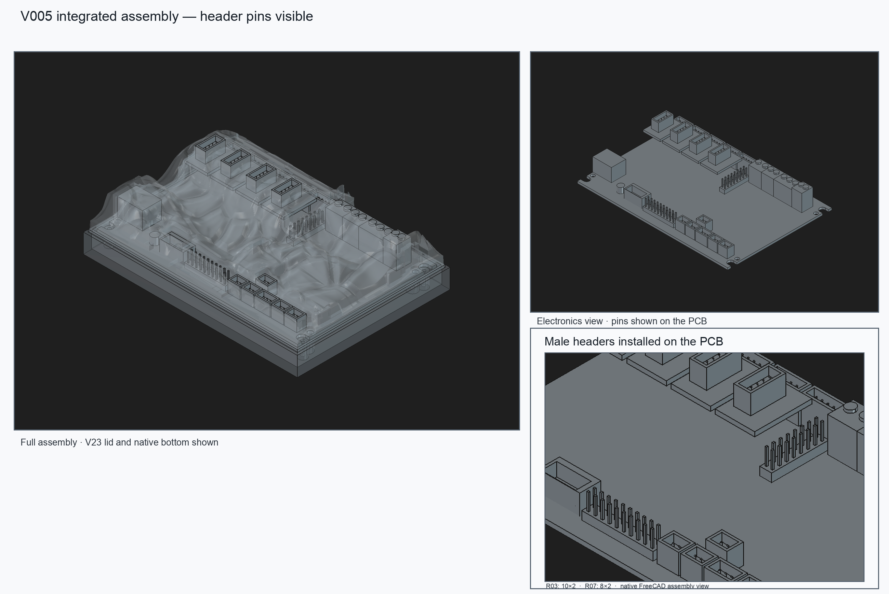

## Master references and access geometry

I used the constrained PCB master as the positional authority. The recovered R08 dependency chain links the terminal housing placement to each screw axis, then links the axis to native access features.

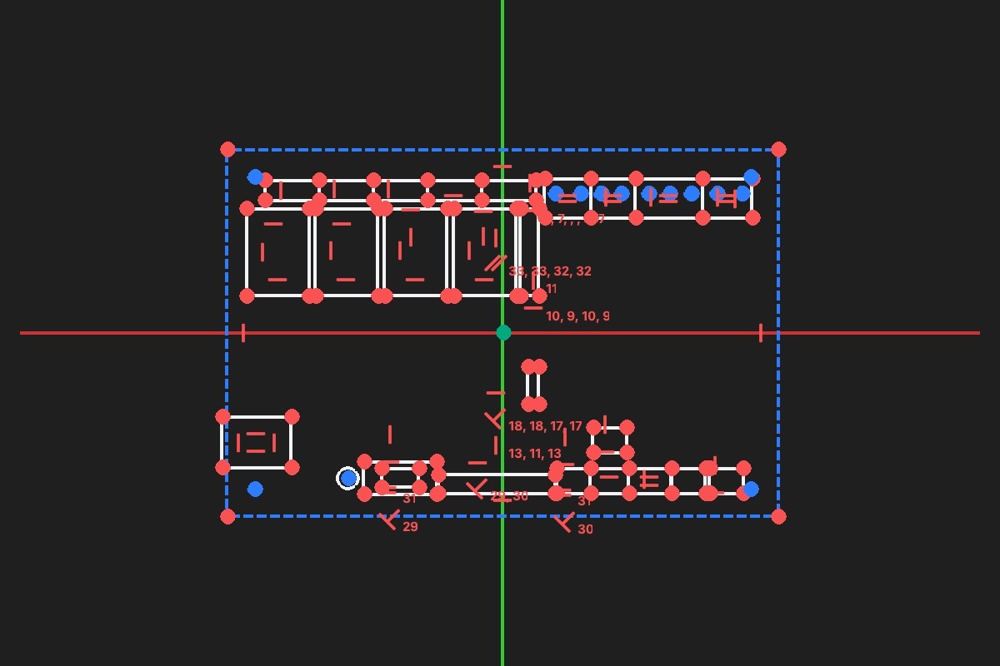

*The saved sketch records construction geometry and reference constraints used during PCB layout modeling.*

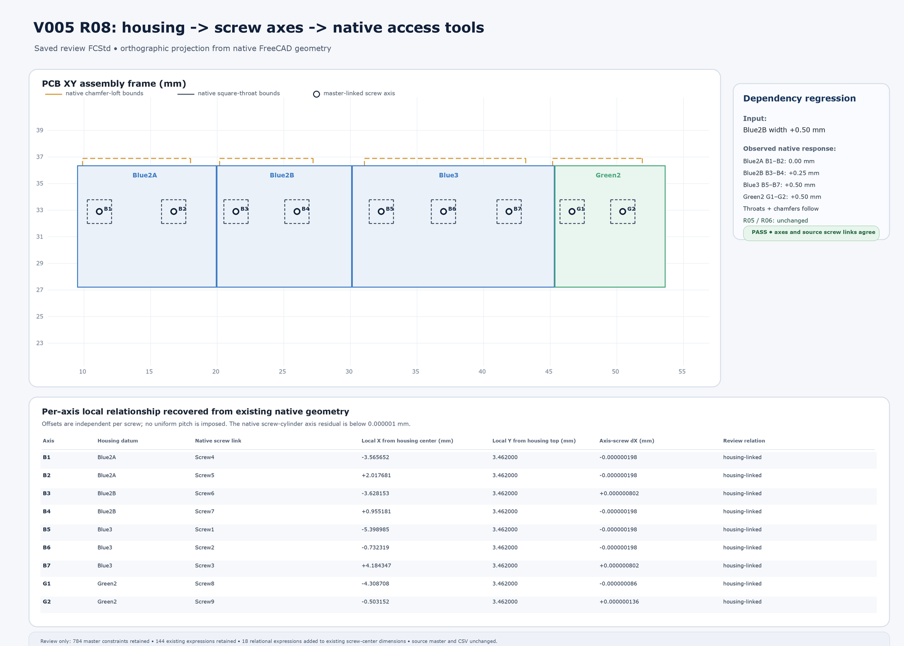

*Geometry-derived review diagram from the FreeCAD recovery work. The source FCStd remains in the local engineering archive and is not included here.*

## V23 cover and V24 assembly views

V23 carries the organic faceted exterior and the original functional opening layout. The oblique and top views show different aspects of the same saved cover render set.

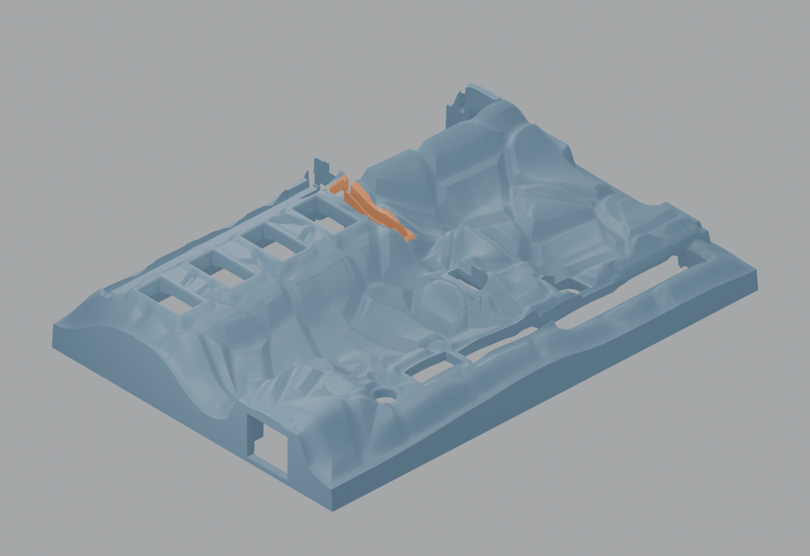

*Saved V23 + R07 cover render. It is a mesh-based computational artifact, not a parametric reconstruction of every exterior surface.*

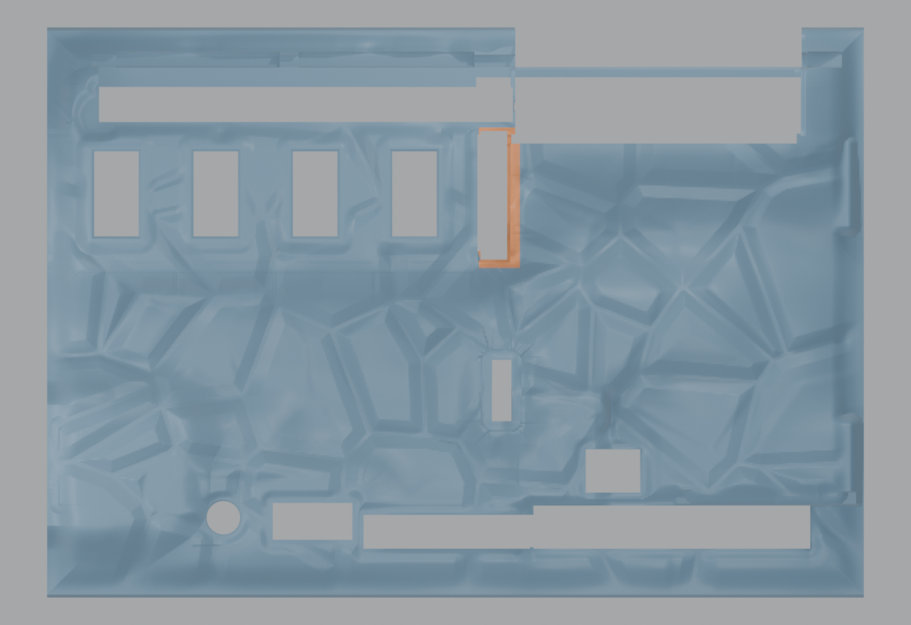

The current Blender renders use the V24 lid and base STL files with the saved PCB/component OBJ. The OBJ import is explicitly Z-up; its saved assembly positions, rotations, scale, and X/Y registration are preserved.

*Computational review candidate rendered from saved exported geometry. Lid/base seating and component fit still need physical verification.*

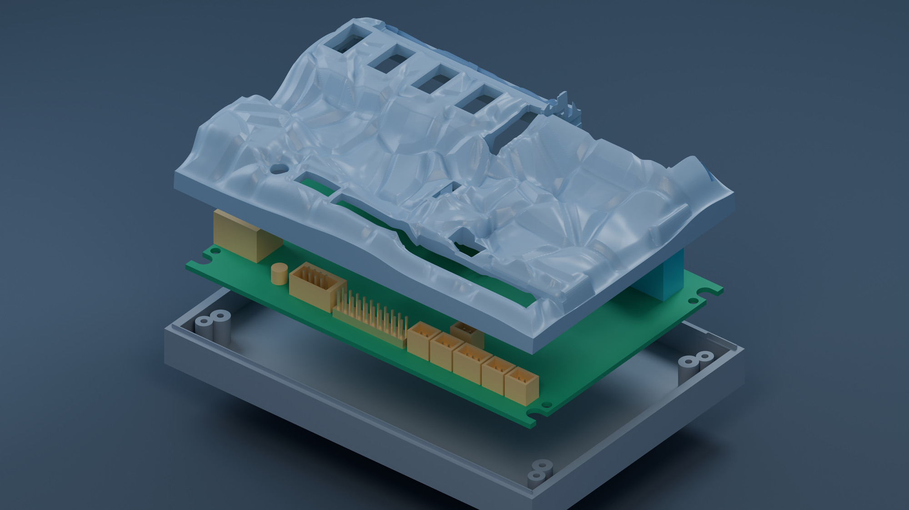

*Display translations are along Z only; all component rotations and X/Y registrations are preserved.*

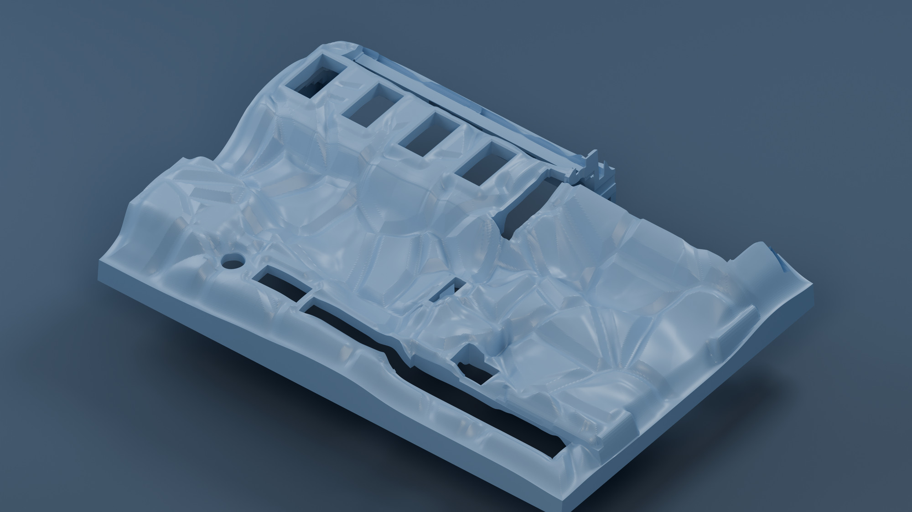

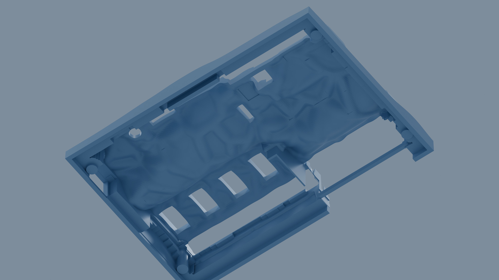

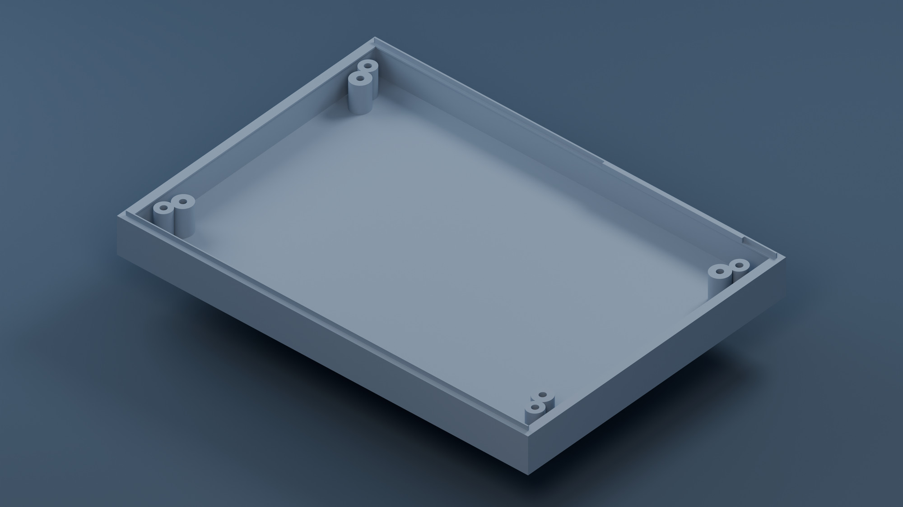

The previously saved V24 computational closed/exploded PNGs remain available as [closed assembly reference](../assets/images/revisions/v24-computational-candidate.png) and [exploded assembly reference](../assets/images/revisions/v24-exploded-reference.png); the current renders use the same saved input geometry with higher-quality local lighting.

## R07 support integration

R07 was treated as a local support and access problem around the real header placement and neighboring reference regions. The saved section shows the cover and support geometry at a cut through that area.

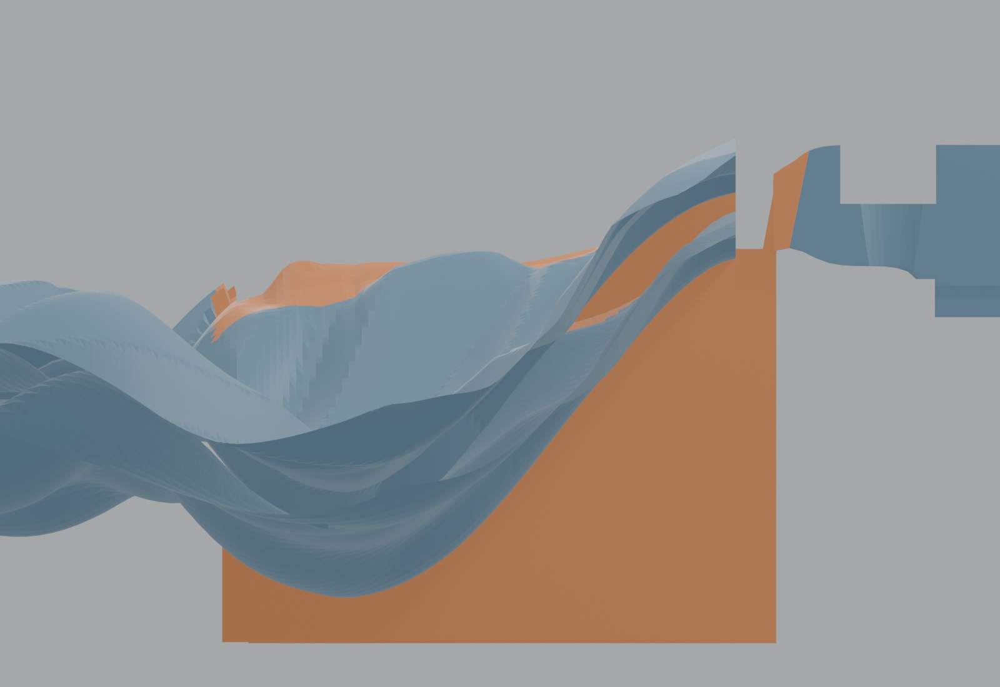

The native support geometry and the mesh integration were separate engineering stages. A mesh Boolean can preserve the surface outside a local region while still leaving physical clearances unresolved. I therefore describe these results as computational review, not manufacturing acceptance.

## What the enclosure work changed in the software

The design work led me to build a reusable generator rather than leave the procedural operation embedded in one project. Its public API and CLI make seeds and settings explicit, its manifests record provenance, and its validators reload exported files before checking mesh topology.

The recovered historical values are seed `20261110`, 55 cells, and 1.8 mm relief. The public Doesbot example applies those settings to a sanitized slab; it does not reproduce V23. Enclosure supports, openings, reinforcements, and mating features remain CAD operations outside this repository.

## What remains unverified

The saved views document engineering intent and computational geometry. They do not prove the simplified component bodies match vendor models, that every connector has physical clearance, that the cover fits the base after printing, or that the enclosure will survive use. Those require authoritative component geometry, physical measurements, and fit/print checks.

For the reusable software, see the [generator README](../../README.md), [technical guide](../engineering/guide.md), [full preset gallery](../gallery/README.md), and [engineering story](../story/from-hardware-to-procedural-geometry.md).
