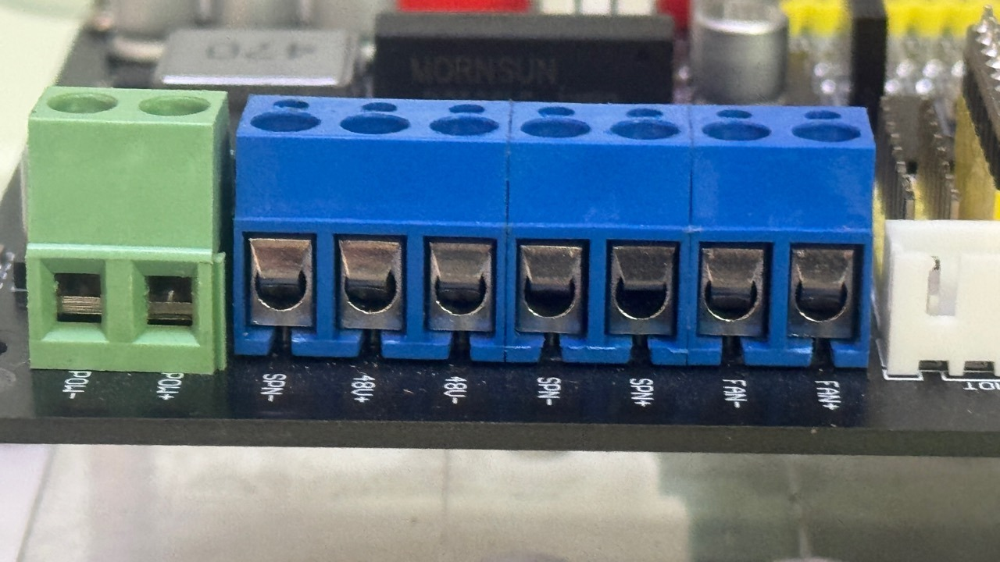
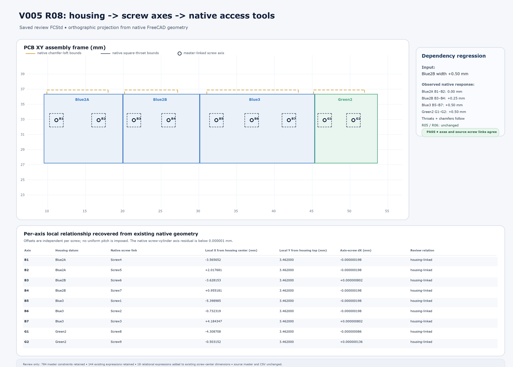
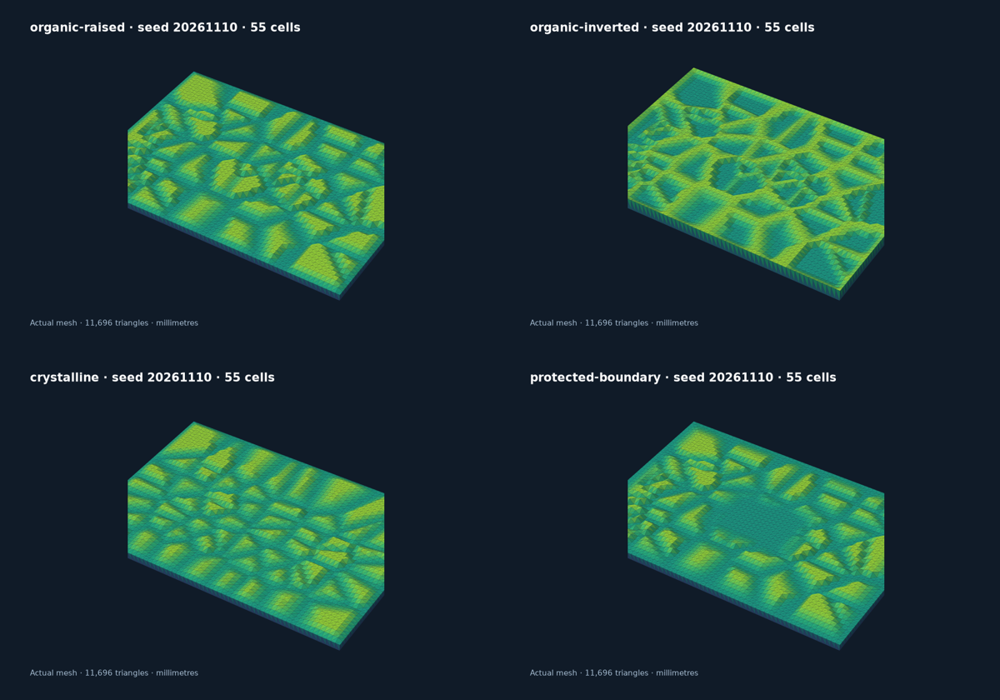
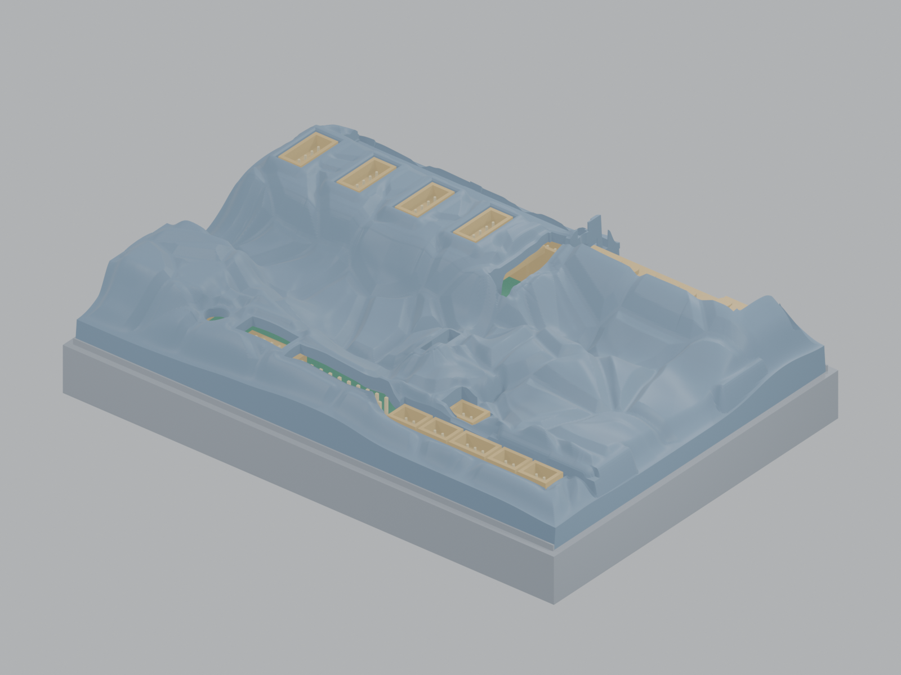
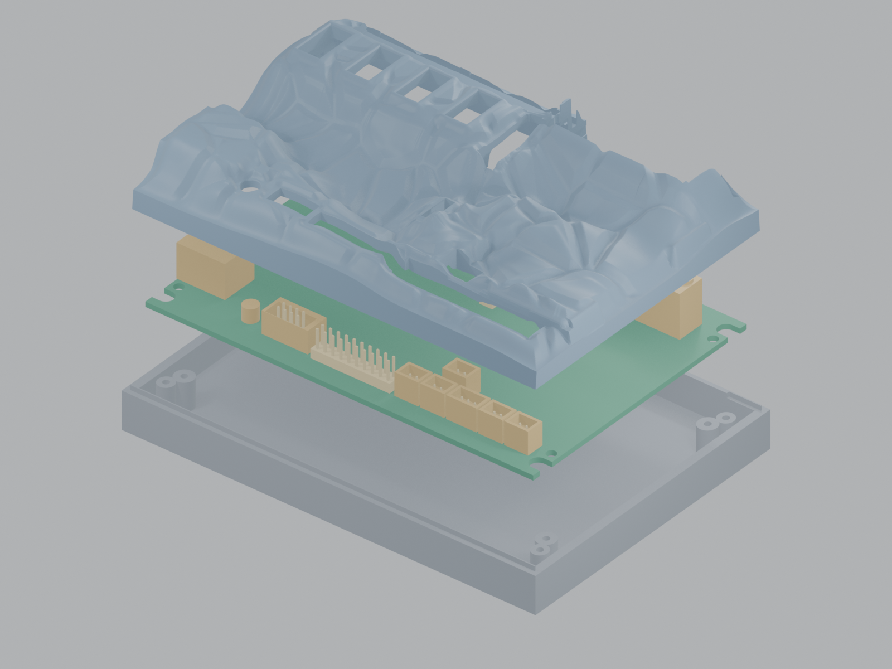

# From hardware to procedural geometry

I’m David Cannan, and I approach hardware problems through the tools I know: programming, automation, systems work, and experiments I can repeat. I’m self-taught. This project started with a Doesbot CNC controller enclosure, rather than a plan to write a geometry library.

## Start with the board

The board had connectors, headers, terminal screws, and mounting features that the enclosure needed to respect. A pleasing surface would be useless if it blocked those interfaces. I collected physical photographs and measurements and used native FreeCAD references to keep the mechanical layout authoritative.

*Actual hardware reference supplied during the project. The photograph is evidence of the component arrangement, not a calibrated CAD drawing.*

## References before decoration

The native PCB master eventually held 784 constrained relationships. One lesson was that an assembly link by itself does not make downstream geometry parametric. I needed a real dependency from component placement to screw axes and access tools. The recovered R08 work made that distinction visible.

*Saved geometry-derived dependency preview from the FreeCAD recovery work. This public repository does not contain the unfinished enclosure CAD tree.*

## Make the surface repeatable

Voronoi relief gave me a way to build a faceted organic surface from a seed and a small set of parameters. The recovered historical evidence records seed 20261110, 55 cells, and 1.8 mm relief. Those values matter because they describe a repeatable experiment. They do not magically reconstruct all the later enclosure operations.

*New generated slab using recovered parameters. This is deliberately labeled separately from V23.*

The public engine queries the nearest two sites, turns their distance relationship into a relief field, protects boundaries, and triangulates the result. I can change seed, cell count, relief, distribution, or a protected region without redrawing the model.

## What failed in the enclosure workflow

The difficult part was joining native mechanical features to an existing large triangle mesh. A full mesh-to-B-rep conversion was expensive and did not recover a useful parametric surface history. Native features and mesh operations needed different responsibilities. FreeCAD could define the support and hardware relationships; a mesh Boolean engine could integrate them into the organic shell.

I also learned to distrust a successful Boolean as the final answer. A watertight mesh can still obstruct a component, and a nominally coincident mating surface is not printable clearance. Export precision can introduce tiny slivers. One detector’s intersection candidates need independent checking rather than an automatic pass or automatic rejection.

*V24 computational review candidate, not a physical-fit or manufacturing release. R02 seating, access, thickness and physical verification remained open in the enclosure work.*

A rendering bug provided another reminder: the OBJ importer rotated the component references relative to the STL. The wrong exploded picture was not merely unattractive; it communicated the wrong assembly. I corrected the import axes and derived the exploded view from translations along the same assembly axis.

*Assembly-axis translations for presentation only. Rotations and XY registration are retained.*

## What became reusable software

The public project separates configuration, deterministic sites, relief, masks, solidification, validation, exports, and rendering. The CLI, Python API, and browser call the same engine. Each build saves its configuration, input hash, dependency versions, validation, and output hashes. Tests cover reproduction and documentation images because a broken README preview is also a broken deliverable.

The useful result is a tool I can run on the next geometry experiment without carrying along the unfinished enclosure. It has real limits: imported surfaces need appropriate sampling and orientation, constant thickness here means vertical thickness, and computational checks do not prove a print will fit. Those limits are part of the engineering record, not something I want a render to hide.
