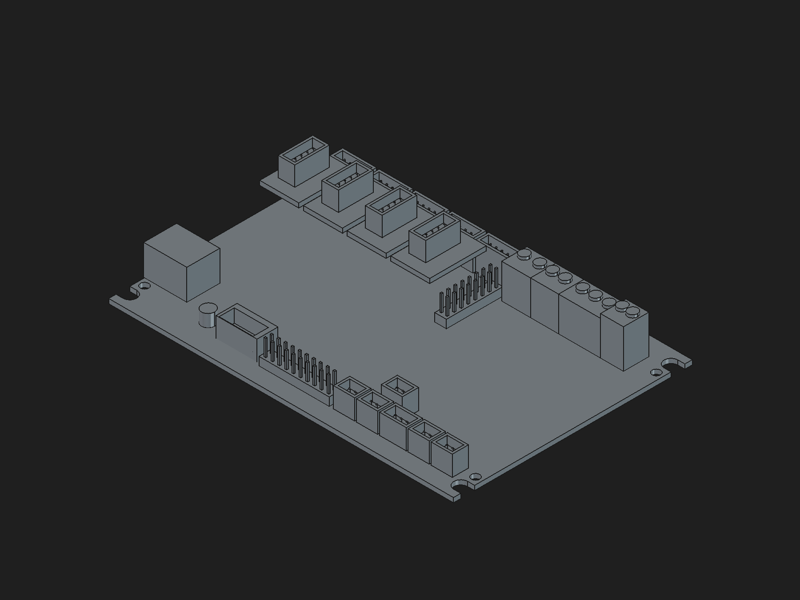
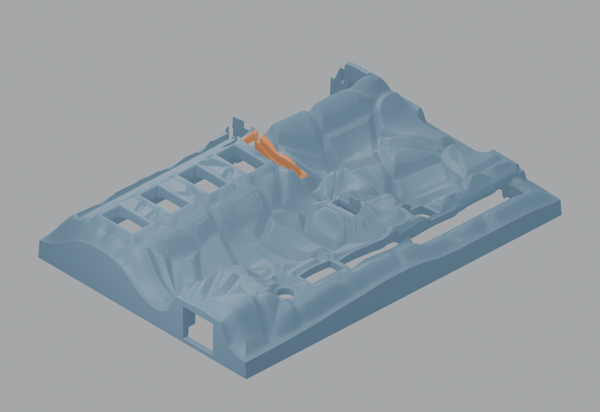
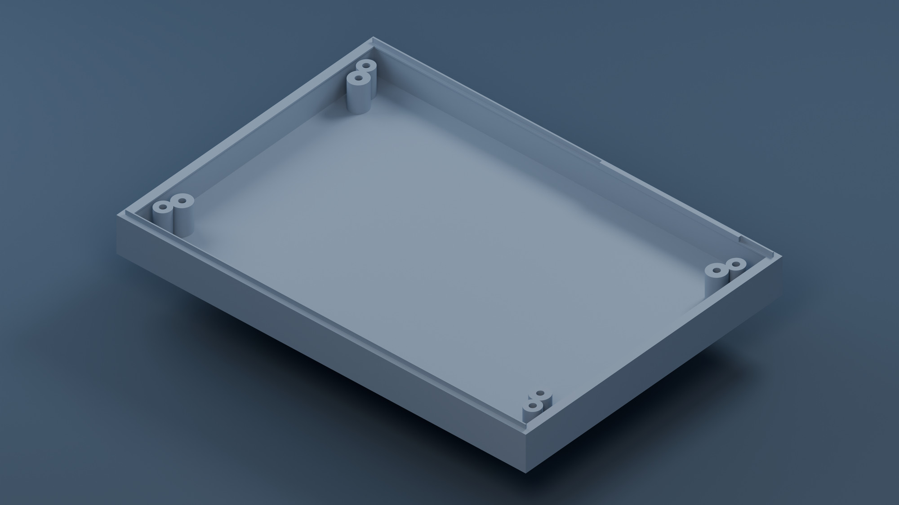
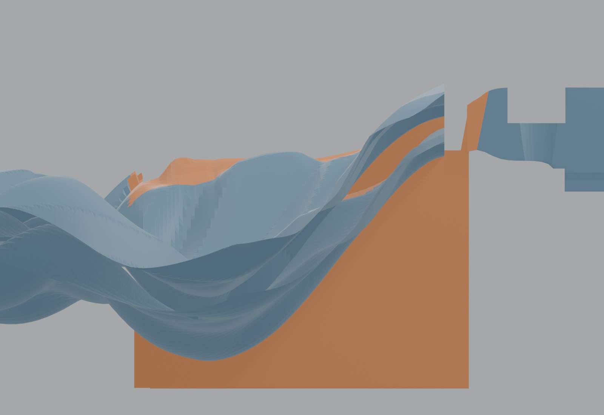

# From hardware to procedural geometry

I’m David Cannan. I work through hardware problems with programming, automation, systems thinking, and experiments I can repeat. I’m self-taught, and this project began with a Doesbot CNC controller enclosure—not with a plan to publish a geometry library.

## Start with the board

The controller already had terminal blocks, headers, flush connector interfaces, and mounting features. An enclosure could look interesting and still fail at its job if it covered a connector or put a support into a component. I used the physical board and its saved references to define the mechanical problem.

*The close-up is a user-supplied hardware photograph. It documents the terminals, not calibrated dimensions.*

The full PCB model and its installed component references made the placement relationships easier to inspect than the close-up alone. The header rows and connector bodies were useful for checking where an opening or support could go, although some component shapes remained simplified references.

*Native FreeCAD assembly reference from the V005 work. It is not a manufacturer STEP model for every component.*

## Keep the reference geometry authoritative

The PCB master sketch and named dimensions carried the positional intent. Over time it accumulated hundreds of constraints. A FreeCAD `App::Link` helped place an object, but did not by itself make downstream geometry depend on the source component. I needed actual geometric references and expressions to carry the relationship forward.

*The saved review diagram shows terminal housings driving nine screw axes, then native throat and chamfer tools. It is a geometry-derived dependency view; the unfinished enclosure CAD is not included in this repository.*

One practical lesson from that work was to separate what the model knows from what a picture suggests. Per-connector measurements, housing footprints, screw centers, and access shapes need explicit, traceable relationships. I kept the historical CSV revision conflicts unresolved where the source revision was not authoritative.

## Shape the cover around the interfaces

I wanted an organic Voronoi roof, while the component positions and functional openings still came from the mechanical references. The V23 cover kept the faceted surface language and the existing connector layout. R07 then became a focused support and access problem involving a two-by-eight header and neighboring R05, R06, and R08 regions.

*Saved V23 + R07 cover render from the engineering workspace. It is a computational review artifact, not a claim of verified physical fit.*

The top view makes the functional openings easier to read against the surface.

## Bring the parts back together

The cover alone does not show how the enclosure relates to the board and lower shell. The Blender renders below use the exported V24 lid and base meshes with the saved assembly OBJ. I explicitly set Blender's import axes to retain the CAD Z-up frame; no scale or rotation is applied. The exploded view translates parts along assembly Z while keeping component rotation and XY registration.

*Saved computational review render. This assembly has not been physically fitted or print-tested.*

The older saved V24 assembly PNGs are retained in the image archive; these current renders were generated from the same saved geometry with a repeatable local lighting and camera setup. GitHub Actions continues to render the generic procedural samples separately. See the [two-tier rendering guide](../rendering/README.md).

The component reference below shows the header pins clearly in the saved FreeCAD assembly view. It captures why the opening and support placement had to be reviewed together.

*Historical V005 reference view. It documents component visibility and placement; later V23/V24 enclosure renders are shown separately.*

For R07, I used sections to inspect where the native support meets the V23-derived cover mesh.

*Saved geometry-derived section from the R07 integration review. A section helps inspect the local interface; it does not prove complete clearance, physical fit, or printability.*

The enclosure review exposed a broader modeling lesson: a geometry operation that completes is not automatically a correct mechanical result. I encountered expensive mesh-to-B-rep conversion, mesh seams, intersections, a wrong exploded view, and ambiguity between intentional contact and usable clearance. I kept the V23 baseline unchanged and treated later integration work as separate computational revisions.

## Make the surface repeatable

Voronoi relief gave me a way to generate a faceted organic surface from a seed and a small configuration. Historical evidence recovered from the enclosure work records seed `20261110`, 55 cells, and 1.8 mm relief. I preserved those values in a public example, but applied them to a sanitized slab.

*This public generated example is a new slab. It is not a reconstruction of V23.*

The engine samples a field based on nearby Voronoi sites, then applies relief styles, protected regions, and optional solidification. Its configuration, seed, input hash, dependency versions, validation, and export hashes are written with each build.

These samples are for comparing the generator. The enclosure cover, native supports, and mating geometry are separate saved engineering outputs; the public Python project does not recreate them.

## What became reusable software

The repository separates configuration, deterministic site generation, relief, masks, solidification, validation, export, and rendering. The Python API, command line, and browser interface call the same implementation. Ready-to-run examples and presets mean a new user can generate geometry without first building a parameter file by hand.

The remaining limits are explicit. Imported mesh relief moves existing +Z-facing vertices instead of conformally remeshing arbitrary curved surfaces. “Constant thickness” means vertical thickness. Computational validation cannot establish hardware clearance, real-world fit, printer behavior, or print success. I want the tool to make its work repeatable and its limits visible.

[Open the dedicated Doesbot enclosure visual case study](../showcase/doesbot-cnc-enclosure.md) or read the [geometry engine guide](../engineering/guide.md).
