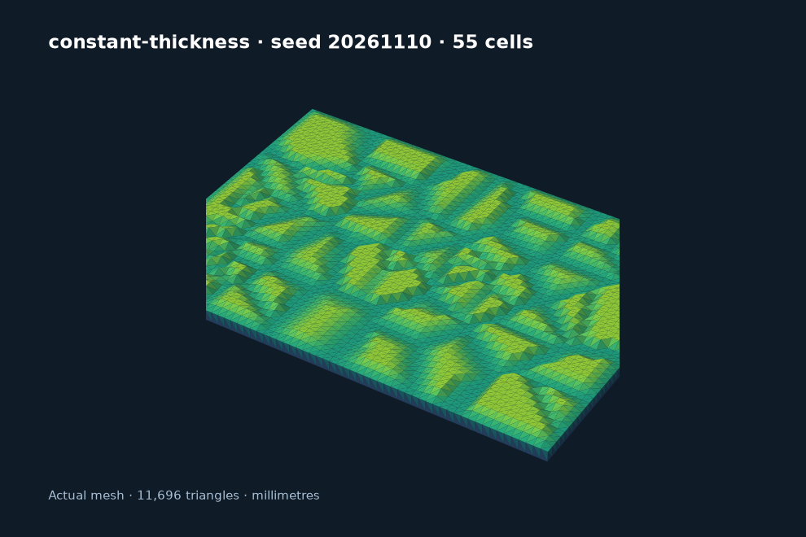

# constant-thickness

Vertical constant-thickness shell; normal thickness is not constant.



Seed 20261110; actual configuration in resolved.yaml and validation in validation.json.

```sh
voronoi-mesh generate --preset constant-thickness --output generated/constant-thickness
```
