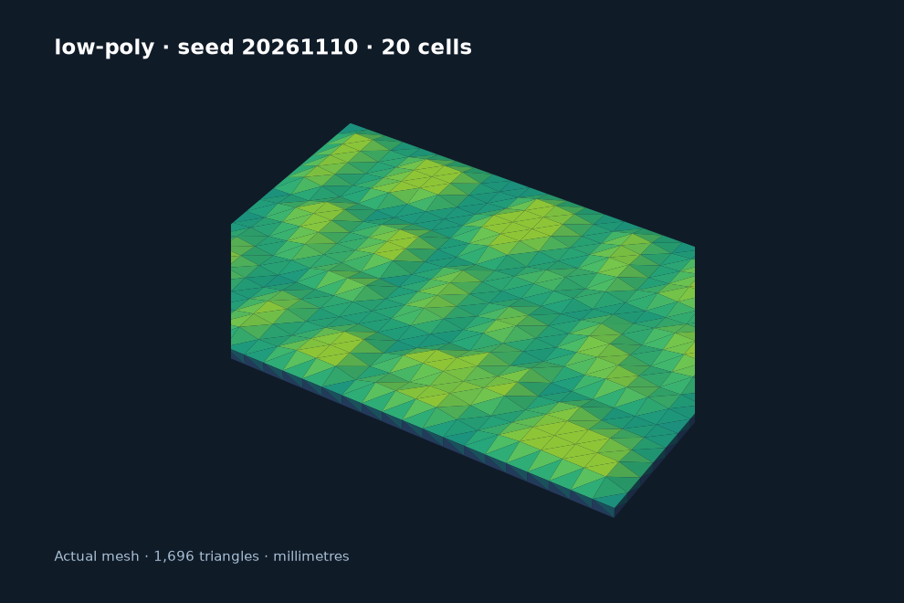

# low-poly

Sparse angular surface sampling and low cell count.



Seed 20261110; actual configuration in resolved.yaml and validation in validation.json.

```sh
voronoi-mesh generate --preset low-poly --output generated/low-poly
```
