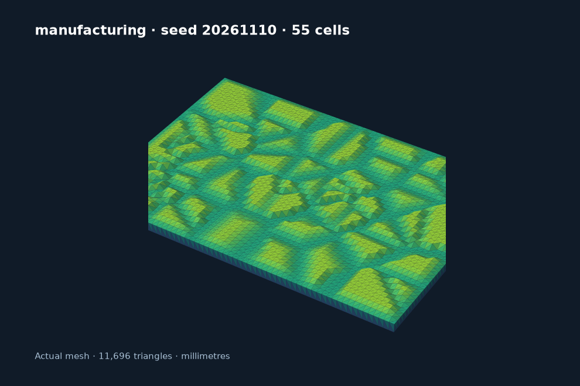

# manufacturing

Conservative vertical substrate thickness with strict topology gates.



Seed 20261110; actual configuration in resolved.yaml and validation in validation.json.

```sh
voronoi-mesh generate --preset manufacturing --output generated/manufacturing
```
