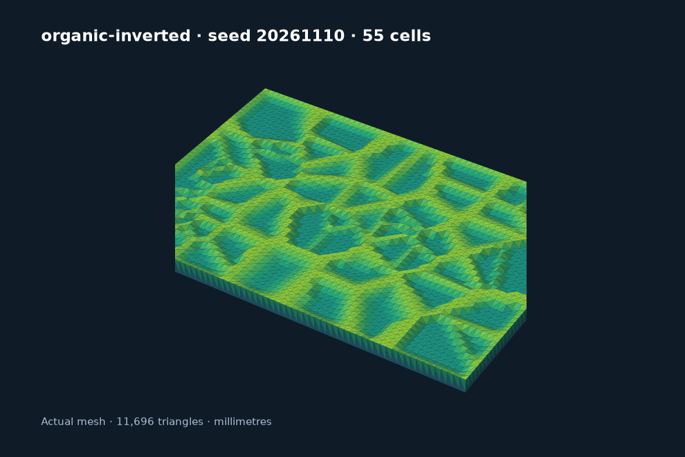

# organic-inverted

Rounded inward Voronoi relief over a solid slab.



Seed 20261110; actual configuration in resolved.yaml and validation in validation.json.

```sh
voronoi-mesh generate --preset organic-inverted --output generated/organic-inverted
```
