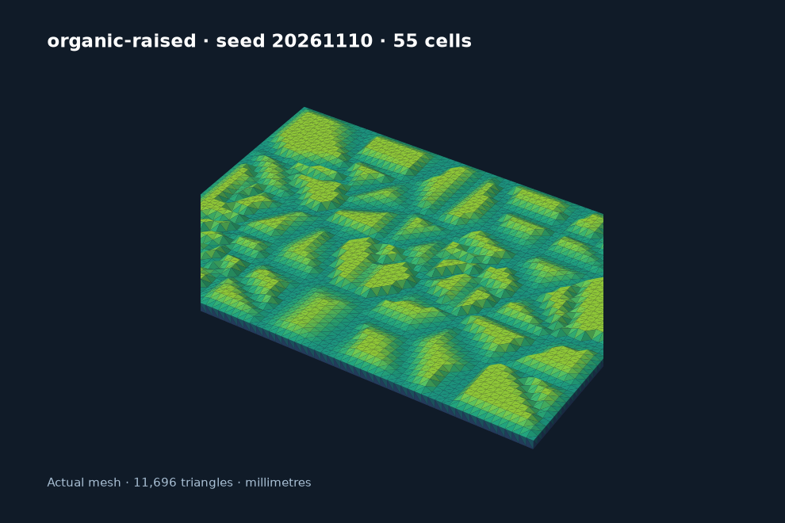

# organic-raised

Rounded raised Voronoi cell centers.



Seed 20261110; actual configuration in resolved.yaml and validation in validation.json.

```sh
voronoi-mesh generate --preset organic-raised --output generated/organic-raised
```
