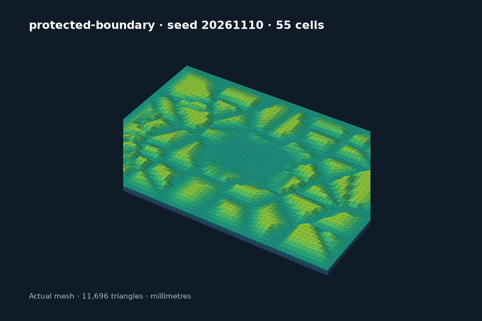

# protected-boundary

Fixed outer boundary and a flat protected central rectangle.



Seed 20261110; actual configuration in resolved.yaml and validation in validation.json.

```sh
voronoi-mesh generate --preset protected-boundary --output generated/protected-boundary
```
