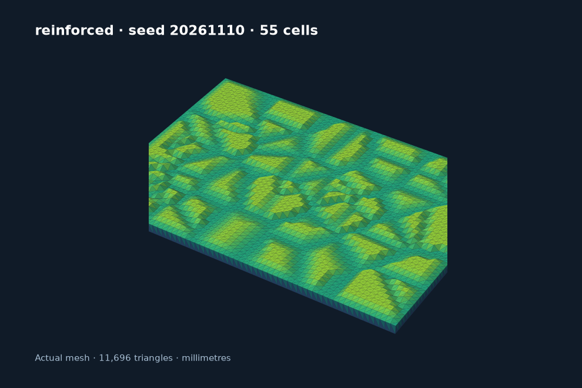

# reinforced

Thicker substrate with strict computational validation.



Seed 20261110; actual configuration in resolved.yaml and validation in validation.json.

```sh
voronoi-mesh generate --preset reinforced --output generated/reinforced
```
